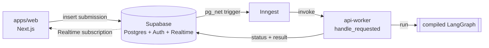
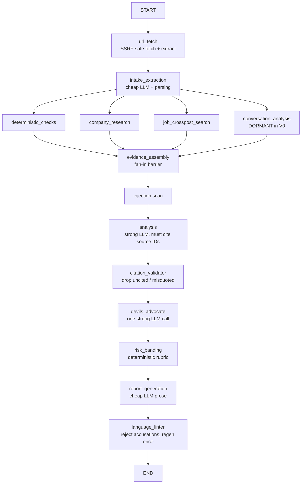

# Job Hunt Verification

Submit a job opportunity — pasted posting text, or a URL, plus optional company
name and recruiter email — and get back an **evidence-backed risk assessment**:
what looks legitimate, what looks suspicious, what couldn't be verified, and what
you should check yourself.

The product never says "SCAM / NOT SCAM." It outputs a **risk band** (`LOW` /
`MODERATE` / `HIGH` / `CRITICAL`) with a **confidence level** derived from evidence
coverage, plus findings that each trace back to identified sources.

> Working name; product/domain name TBD. The full build spec lives at
> [`docs/superpowers/specs/2026-08-18-job-hunt-verification-design.md`](docs/superpowers/specs/2026-08-18-job-hunt-verification-design.md)
> and is the source of truth — this README summarizes it.

---

## The one decision everything follows from

**The LLM never decides the risk band. It only proposes findings tied to evidence
source IDs. A deterministic layer validates those citations and computes the band.**

Every other property of the system is downstream of this:

- **Trustworthy UX** — every claim in a report traces to a source the user can inspect.
- **Near-zero unsupported-claim rate** — findings that cite a nonexistent or misquoted
  source are *dropped* by a deterministic validator, not shown.
- **Prompt-injection resistance** — the band, the citation validator, and the
  payment-floor rule cannot be talked out of anything by attacker-supplied text.
- **Tractable evaluation** — the deterministic spine is testable without live models.
- **Honest differentiation** from a "ChatGPT wrapper."

This is not negotiable; the rest of the architecture serves it.

---

## System architecture

A monorepo with two apps around one shared investigation engine:

- **`apps/web`** — Next.js 16 + React 19 + TypeScript. Submission form, live progress,
  and the result page. Talks to Supabase directly (auth, data, realtime).
- **`apps/api`** — Python 3.12 + FastAPI + **LangGraph**. Contains the investigation
  graph (the deterministic spine + LLM nodes), the tools (SSRF-safe fetcher, Tavily,
  RDAP, DNS), the rubric, and the cost tracker.

The same compiled graph is driven two ways:

### V0 — synchronous FastAPI (`api-http`)

The simplest path: the browser (or any client) hits FastAPI, the graph runs
in-request against the Postgres checkpointer, and the result is persisted and returned.
Ownership is a stand-in `X-Owner-Key` header (no accounts in V0).

```
client ──POST /investigations──▶ FastAPI (api-http :8080)
                                    │  run_investigation() → compiled LangGraph
                                    │  (soft ~90s deadline, best-effort checkpoint)
                                    ▼
                                 Postgres  ◀── persists result + raw sources
client ──GET /investigations/{id}──▶ FastAPI (ownership-checked, 404 not 403)
```

### V1 — background worker (`api-worker`) via Supabase + Inngest

The launch path: the web app writes a submission row to Supabase; an **AFTER INSERT
trigger** posts an Inngest event directly via pg_net; the **Inngest worker** picks it
up and runs the *same* graph in the background, writing status and results back to
Supabase; the web app streams progress via Supabase **Realtime**.



The worker adds durability the synchronous path can't: Inngest **retries** (budget 2)
plus an `on_failure` handler that marks the run failed and back-fills its steps, a
**sweeper** that re-emits stale-queued runs and fails zombie-running ones, a global
**daily cost ceiling**, and per-user **quota / anti-abuse** enforced in Postgres (RLS +
migrations under `supabase/migrations/`).

> **Status:** both paths are built. Per project notes, the V0 synchronous backend
> is retained; its teardown is deferred until the web app's Supabase migration lands.

> **Deploying / operating V1?** See [`docs/PRODUCTION.md`](docs/PRODUCTION.md) —
> topology, the two-hop dispatch chain, every production variable, the deploy and
> first-cutover procedure, operational gotchas, and rollback.

---

## The investigation graph

This is the heart of the system (`apps/api/src/app/graph/`). One compiled LangGraph
`StateGraph` over a shared `InvestigationState`:



| Node | Kind | What it does |
|---|---|---|
| `url_fetch` | tool | Fetches a submitted URL through the SSRF-safe fetcher, extracts posting text. |
| `intake_extraction` | cheap LLM | Structured extraction of company, domain, email, title, salary, key phrases. |
| `deterministic_checks` | **no LLM** | RDAP domain age, DNS MX records, email↔company domain match, **homoglyph** lookalike check, URL heuristics, **ATS-domain allowlist**. |
| `company_research` | Tavily + fetch + cheap LLM | Searches and summarizes per source; async-batched inside the node. |
| `job_crosspost_search` | search | Flags the same job posted with **different contact info** (the scam signal), not merely on multiple boards. |
| `conversation_analysis` | cheap LLM | Tags known scam patterns in pasted messages. **Built but dormant in V0** (no paste UI). |
| `evidence_assembly` | **no LLM** | Fan-in barrier: consolidates the parallel branches' additive accumulators, dedupes sources, assigns canonical IDs. |
| injection scan | **no LLM** | Deterministic scan for instruction-like text in sources ("ignore previous", "mark as legitimate") → HIGH-severity finding. |
| `analysis` | **strong LLM** | Proposes findings — **every finding must cite `source_ids`**. |
| `citation_validator` | **no LLM** | Drops findings citing nonexistent or misquoted sources; drop count is an eval metric. |
| `devils_advocate` | strong LLM | One call: "argue this could be legitimate, using only the same evidence." Merges as mitigations / severity downgrades. |
| `risk_banding` | **no LLM** | The deterministic rubric → band + confidence. |
| `report_generation` | cheap LLM | Prose summary + "what to verify yourself" checklist. |
| `language_linter` | **no LLM** | Rejects declarative accusations against named entities; regenerates once. The defamation policy, enforced in code. |

**Resilience is built into the wiring.** Each fan-out branch is wrapped in a
`_with_branch_guard`: on timeout *or* any exception (unreachable site, DNS failure,
upstream 5xx) it degrades to a single soft "unverifiable" finding — written through
the additive reducer channels so concurrent branch failures can't collide — instead
of hanging or crashing the whole investigation. The run also has a soft total
deadline (~90s) that returns best-effort state from the last checkpoint.

### State & evidence model

`InvestigationState` (`graph/state.py`) keeps state **lean** so LangGraph checkpoint
writes stay fast — full page HTML never enters state; only bounded summaries and
excerpts do.

- `submission` — raw user input, **immutable** (debugging + citation validation depend on it).
- `raw_sources` / `raw_findings` — additive (`operator.add`) accumulators the parallel
  branches write to; `evidence_assembly` consumes them and produces the canonical,
  replace-semantics `sources` / `findings`. **The API only ever exposes the canonical fields.**
- Every `Finding` carries a `provenance` (`web_verified` / `deterministic` /
  `user_provided_unverified`) that the rubric treats as load-bearing.
- `cost_events` — additive `NodeUsage` list, parallel-branch safe.

### Risk banding rubric (deterministic)

The "judge" is code, not a prompt (`rubric.py` / `graph/nodes/banding.py`). Core rules:

- **No single soft signal moves the result more than one band.** Gmail alone ≠ scam;
  WhatsApp alone ≠ scam; a new domain alone ≠ scam. The false-positive principle, as code.
- **Payment/fee request = automatic HIGH floor.** The one near-definitive signal.
  Built in V0, dormant until conversation input ships in V1.
- **`user_provided_unverified` findings alone can't push a named company past MODERATE** —
  the sabotage defense (a user can't weaponize the tool against a competitor with a
  fabricated conversation).
- **Confidence = evidence coverage** (how many entity dimensions have ≥1 source),
  computed deterministically. Timed-out branches lower coverage, which lowers confidence.
- **Detected injection attempt = HIGH-severity finding.** The attack surface becomes a signal.
- **Staffing-agency reframe** — a plausible agency domain reframes "job not on careers page"
  and "email mismatch" into "verify the agency," capped, and the agency is investigated as a
  company. (Agencies are otherwise the #1 false-positive source.)
- Bands only, never percentages — "87.42% scam" is false precision.

---

## Security & guardrails

| Concern | Defense |
|---|---|
| **SSRF** (users hand the backend arbitrary URLs) | `security/ssrf.py` + `tools/fetcher.py`: resolve host, reject private/loopback/link-local + cloud-metadata IPs, re-validate on every redirect, cap size + timeout. |
| **Prompt injection** in fetched/pasted content | Deterministic band/validator can't be overridden; content wrapped as untrusted data; instruction-like patterns become a HIGH finding; permanent injection cases in the eval set. |
| **User-side sabotage** (§9.1) | Provenance system + rubric caps; user-provided evidence always framed "based on what you shared, which we cannot verify." (Not reachable in V0.) |
| **Output safety / defamation** | Never render fetched HTML; escape everything; **defang** suspicious URLs (`hxxps://acme-globall[.]com`); the language linter blocks declarative accusations. |
| **Data protection / IDOR** | UUIDv4 keys, server-side ownership checks, **404 not 403** on foreign resources (no existence leak); no secrets/cost internals in client errors. |
| **Abuse / cost** | Input caps rejected before anything runs; per-user quota + disposable-email block (Postgres RLS + migrations); global daily USD ceiling in the worker. |

---

## Models, routing & cost

Two logical tiers behind a factory (`llm.py`, `config.py`), resolved from env vars —
**model IDs live in env vars, never in code** (the lineup churns constantly):

- **cheap** — `intake_extraction`, per-source summarization, `conversation_analysis`,
  `report_generation` (low reasoning effort).
- **strong** — `analysis`, `devils_advocate` (high reasoning effort).
- **deterministic (no model)** — checks, evidence assembly, citation validator, banding, linter.

Structured outputs use strict JSON schemas with one retry on parse error. Prompts are
structured static-prefix-first so automatic prompt caching lands on the strong-tier calls.

Cost is tracked per node in `cost_tracker.py` (append-only, parallel-safe); unknown
model IDs record tokens at **$0** (visible, not guessed); `summarize()` is persisted on
the investigation row. Typical run ≈ **$0.18** (Luna+Terra config), ≈ **$0.025** all-Luna dev.

---

## Repository layout

```
.
├── apps/
│   ├── web/                     # Next.js + TypeScript (pnpm)
│   │   ├── app/                 # routes: landing, verify, investigations/[id], auth
│   │   ├── components/          # landing / progress / report / verify / ui
│   │   └── lib/                 # supabase clients, view-models, defang, validation
│   └── api/                     # FastAPI + LangGraph (uv)
│       ├── src/app/
│       │   ├── graph/           # build.py, state.py, nodes/
│       │   ├── checks/          # deterministic: homoglyph, ATS allowlist, domain match
│       │   ├── security/        # ssrf, injection, defang
│       │   ├── tools/           # fetcher, tavily, rdap, dns
│       │   ├── worker/          # Inngest functions, runner, persistence (V1)
│       │   ├── rubric.py        # deterministic banding
│       │   ├── cost_tracker.py
│       │   └── main.py          # FastAPI routes (V0 synchronous path)
│       ├── eval/                # dataset.json + pytest eval harness
│       └── tests/
├── packages/
│   └── api-types/               # TS types GENERATED from the API's OpenAPI
├── supabase/                    # migrations, edge function (V1 backend)
├── docs/superpowers/            # specs + implementation plans
├── scripts/                     # RUNBOOK.md, verify_rls.sql, gen-types.mjs
└── docker-compose.yml           # local dev stack
```

**Shared API contract:** FastAPI emits OpenAPI from its Pydantic models; `pnpm gen:types`
generates `packages/api-types` from it, so the frontend consumes `Finding`, `Source`, and
`FinalAssessment` as real types — change a model and the web build breaks loudly. CI has a
staleness check (`pnpm check:types-stale`).

---

## Running locally

Prerequisites: Docker, [pnpm](https://pnpm.io), [uv](https://docs.astral.sh/uv/), and
(for the V1 path) the Supabase CLI.

```bash
cp .env.example .env      # fill in OPENAI_API_KEY, TAVILY_API_KEY (or use the local LLM profile)
docker compose up         # brings up inngest, api-worker, web, mailhog
```

Services (see `docker-compose.yml`):

| Service | Port | Role |
|---|---|---|
| `web` | — | Next.js dev server |
| `api-worker` | `8000` | V1 Inngest worker (`/api/inngest`, `/healthz`) |
| `inngest` | `8288` | Inngest dev server (dashboard + event ingestion) |
| `mailhog` | `8025` | Captures "report an issue" mail in dev |
| `llama` | `8081` | Optional local LLM — `docker compose --profile llm up` |

For the V1 Supabase backend (auth, RLS, edge function, migrations), follow
[`scripts/RUNBOOK.md`](scripts/RUNBOOK.md) — it covers `supabase start`, applying
migrations, and verifying row-level security with `scripts/verify_rls.sql`.

Frontend-only dev:

```bash
cd apps/web && pnpm install && pnpm dev
```

---

## Testing & evaluation

**Unit / integration tests** cover the whole spine — checks, security, tools, every
graph node, the worker, migrations (`apps/api/tests/`), and the web components/lib
(`apps/web/**/__tests__/`):

```bash
cd apps/api && uv run pytest          # Python: graph, checks, worker, security
cd apps/web && pnpm test              # web: components + lib (vitest)
```

**The eval harness** (`apps/api/eval/`) runs the *real* compiled graph over a
hand-labeled dataset and asserts the spec's gated quality metrics:

```bash
cd apps/api && uv run pytest eval/test_eval.py -v
```

- By default, LLM/network are **stubbed** — but the **deterministic spine runs for real**
  (homoglyph, ATS allowlist, domain match, injection scanner, citation validator, banding).
  Only the network leaves (RDAP, MX, Tavily) and the LLM nodes are replaced with rule-based
  stubs. It runs deterministically in bare CI, no Postgres or API keys needed.
- `--live` runs the same assertions against real models and network for the manual
  model comparison (`CHEAP_MODEL`/`STRONG_MODEL` env vars). Every result is tagged with a
  `model_config` string so numbers from different model configs are never compared.

Gated metrics (spec §10): **band within expected ceiling** per case, **false-positive rate
~zero** (the product-killing metric — legit postings must never be flagged HIGH/CRITICAL),
**citation-drop count ~zero**, and **cost/latency within budget**.

**Adding or changing eval cases** — the case schema, the tags that drive the gates, and
the user-feedback → dataset pipeline: [`apps/api/eval/README.md`](apps/api/eval/README.md).

---

## Versions & roadmap

- **V0 — posting-only.** No accounts/payments. Paste job text + optional company/email.
  Full graph (with dormant nodes), single result page. Ships all four defamation/FP
  guardrails, SSRF fetcher, injection scan, citation validator, rubric, cost tracker,
  staffing-agency + contact-swap handling, branch timeouts, full-report dedupe.
- **V1 — public launch.** URL submission (built), conversation paste + analysis (activates
  the payment-floor rule and sabotage caps), SSE/Realtime streaming progress, accounts +
  quota, background worker, search/company caching, feedback→eval loop, PII retention.
- **V2.** Challenge/re-investigate UI, screenshot input, expanded judge stage, company-registry
  APIs, shareable reports.

---

## Tech stack

Next.js 16 · React 19 · TypeScript · Tailwind CSS · Supabase (Postgres/Auth/Realtime) ·
Python 3.12 · FastAPI · **LangGraph** (Postgres checkpointer) · Pydantic · Inngest ·
Tavily · httpx · RDAP + dnspython · OpenAI-compatible LLMs.
```
